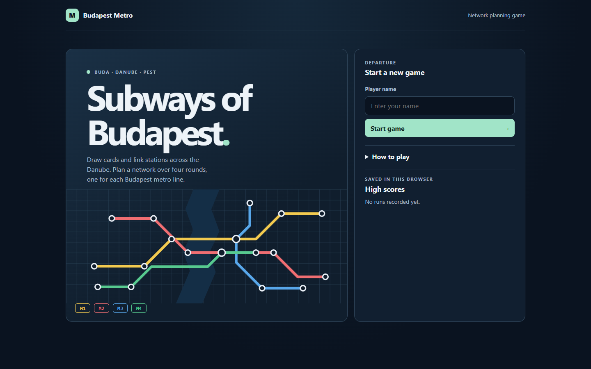
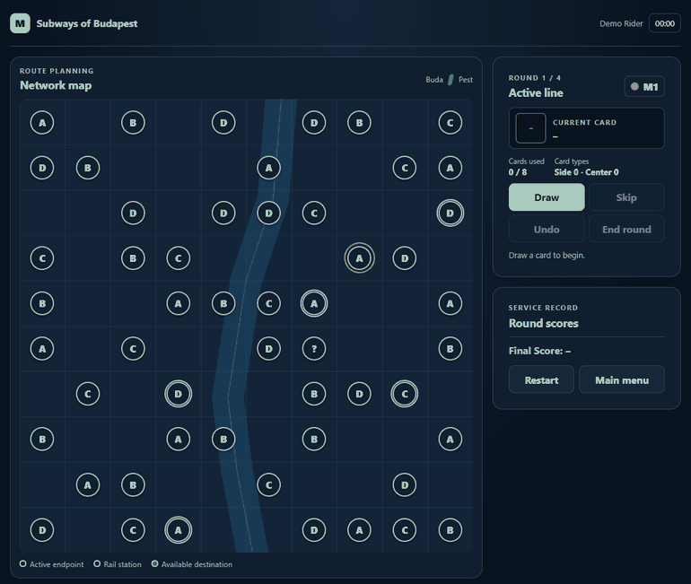

# Subways of Budapest

Build a metro network across Buda and Pest. Draw cards, connect stations on a 10 × 10 grid, and plan four routes across the Danube. Subways of Budapest is an independent educational implementation inspired by the board game *Next Station: London*. The project has no official affiliation with the original game.



[Game board](docs/screenshots/release-game.png) · [Multiple lines](docs/screenshots/release-multi-line.png) · [Mobile gameplay](docs/screenshots/release-mobile-game.png) · [Results](docs/screenshots/release-results.png) · [Screenshot gallery](docs/screenshots/README.md)

<details>
<summary>Watch the gameplay demo</summary>



</details>

## Features

- 53 stations and four metro lines with distinct colors and starting points.
- Card-driven construction with letter, Joker and Switch cards, plus highlighted legal destinations.
- Grid-based route checks for crossings, overlaps, intermediate stations, reused segments and loops.
- Undo, confirmed restart or return to menu, and a final report with line scores, bonuses and elapsed time.
- Responsive layout with native keyboard controls, touch interaction and reduced-motion support.
- Browser-local high scores. The game runs without a backend or runtime npm packages.

## Run locally

Start a static HTTP server from the project root with Python 3:

```sh
python -m http.server 8000 --bind 127.0.0.1
```

Open [the local game](http://127.0.0.1:8000/). Station and line data are fetched over HTTP. The browser needs JavaScript modules and local storage for saving scores. Node.js is only needed for tests.

## Play

1. Enter your name and choose **Start game**. The four lines are played in a shuffled order, one per round.
2. Choose **Draw**. Select the active endpoint, then a highlighted destination. A letter card matches its letter or a wildcard station. A Joker matches any station.
3. Draw horizontal, vertical or 45° segments. Different lines may share a station. A segment cannot cross or overlap another segment, pass through an intermediate station, reuse a station pair or revisit a station on the current line.
4. A **Switch** is counted as a center card and draws a replacement. It allows one branch from a station visited by the current line. **Skip** consumes the current card. **Undo** removes the latest segment on the current line and restores its previous endpoint. The card remains spent.
5. A round can end after eight used cards. Once five cards of one type have appeared, **Draw** and **Skip** lock and **End round** becomes available. After the fourth round, review your report and choose **Play again** or **Main menu**.

Use the mouse, touch, or **Tab** and **Enter**/**Space** to activate controls. **Escape** cancels a restart or leave confirmation.

### Scoring

Each round scores the number of districts reached multiplied by the largest number of visited stations in any one district, plus one point per Buda–Pest crossing. An empty route scores zero. The final report adds a rail-station bonus from a lookup table and a bonus of 2, 5 or 9 points for each station shared by two, three or four lines, respectively. Scores are stored in the current browser and origin.

## Architecture

| File or directory | Responsibility |
| --- | --- |
| `index.html`, `style.css` | Screen layout, inline map illustration, responsive board and visual feedback |
| `script.js` | Session lifecycle, cards, rounds, DOM rendering and local persistence |
| `rules.mjs` | Pure route validation, geometry and scoring |
| `stations.json`, `lines.json` | Original station coordinates, line colors and starts |
| `stations-min.json` | Preserved coursework data |
| `tests/` | Node.js rules tests and Playwright browser checks |
| `docs/` | Authentic captures and development record |

## Test

Use Node.js 24 and npm:

```sh
npm ci
npm run check
npm test
npx playwright install chromium
npm run test:browser
```

The browser runner serves the app under a repository-style subpath. It covers route construction, undo, round locking, scoring, replay, restart, menu navigation and storage, and checks seven viewport widths. GitHub Actions runs the same checks with Chromium on Linux.

## Static hosting

GitHub Pages can serve the project directly from `main` at the repository root. All game assets are relative to the page or module. See [GitHub's publishing-source instructions](https://docs.github.com/en/pages/getting-started-with-github-pages/configuring-a-publishing-source-for-your-github-pages-site).

## Limitations and future work

The board is a schematic and stations occupy fixed grid cells. Small touch targets are tied to that grid, and high scores stay in one browser. Future work could add keyboard spatial navigation and a zoom mode for narrow screens. See the [development record](docs/CODEX_PROGRESS.md) for test coverage and limitations.

Developed by [Toghrul Hasanli](https://github.com/Toghrul-H), originally as university coursework. The menu diagram and board decoration are project-specific inline SVGs. The original coursework data is retained. No commercial artwork or external fonts are bundled.
